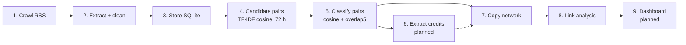

# The Fingerprints of News

**Link analysis of copy and propagation networks in Vietnamese online media**

Capstone project for **IT4868E Web Mining** (semester 20261), Group 10.
Team: Pham Thi Ngoc Anh, Pham Gia Bao, Tran Mai Duong, Vu Thuy Linh.

> Status: work in progress (progress report, 23 Nov 2026). Results below are preliminary.

## What this project does

Vietnamese news outlets often report the same events, and some articles are republished,
lightly edited or rewritten from other outlets, sometimes without credit. We:

1. collect articles from several Vietnamese news sites through their public RSS feeds;
2. find candidate article pairs across outlets and classify whether the later article
   derives from the earlier one (verbatim, near-copy, rewrite) or is independent coverage of the same event;
3. build a directed, weighted **copy network** (edge A -> B: article or outlet B derives from A);
4. apply **link analysis** (PageRank, HITS, community detection, cascade analysis) to find
   original sources, aggregators and copy communities, and to measure how fast stories spread;
5. present the result in an interactive tool (planned) showing who reported first and who credited sources.

## Pipeline



| Stage | Status |
|---|---|
| 1-3 Crawl, extract, store | Done (5 outlets) |
| 4 Candidate pairs | Done |
| 5 Pair classification | Baseline (cosine and text-overlap features) |
| 6 Source credit extraction | Planned |
| 7-8 Copy network, link analysis | Prototype at outlet level |
| 9 Dashboard | Planned |

## Repository layout

```text
.
|-- crawler.py                    # stages 1-3: RSS crawler, text extraction, SQLite storage
|-- requirements.txt
|-- analysis/
|   |-- make_pairs.py             # stage 4: candidate pairs  -> data/pairs.csv
|   |-- sample_for_labeling.py    # sample pairs to annotate  -> data/to_label.csv
|   |-- add_overlap.py            # text-overlap features     -> data/to_label_overlap.csv
|   |-- evaluate_and_graph.py     # evaluation + copy network -> data/outlet_ranking.csv, data/copy_network.png
|   `-- dataset_summary.py        # dataset statistics        -> data/dataset_summary.csv
|-- HUONG_DAN.md                  # step-by-step guide in Vietnamese
`-- data/                         # NOT committed (see "Data policy")
```

## Quick start

Requires Python 3.10+.

```bash
python -m venv .venv
source .venv/bin/activate          # Windows PowerShell: .venv\Scripts\Activate.ps1
pip install -r requirements.txt
```

### 1. Collect data

1. Open `crawler.py` and edit `UA` (put a real contact e-mail) and `FEEDS`.
   Open each RSS URL in a browser first to make sure it works.
2. Run:

```bash
python crawler.py run --once        # one round, to test
python crawler.py run               # run continuously (default: every 10 minutes)
python crawler.py stats             # counts per outlet and status
python analysis/dataset_summary.py  # dataset table for reports
```

The crawler records `first_seen_at` the moment a URL first appears in a feed, before the article
body is downloaded, and keeps the RSS `published_at` separately. It checks `robots.txt`, waits
1.5 s between article requests and retries failed downloads at most three times.
Keep it running on an always-on machine; if it stops, first-seen times are lost.

### 2. Candidate pairs and annotation

```bash
python analysis/make_pairs.py             # data/pairs.csv
python analysis/sample_for_labeling.py    # data/to_label.csv (set N_PER_BIN in the script if you want all pairs)
python analysis/add_overlap.py            # data/to_label_overlap.csv with overlap5 and shared_sents
```

Pairs are articles from **different outlets**, published within **72 hours**, with TF-IDF cosine **>= 0.35**.
The earlier article is `src`, the later one `dst`. Ordering uses RSS `published_at`; articles without it
(Tuoi Tre) are skipped unless `USE_FIRST_SEEN_FALLBACK = True` in `make_pairs.py`.

Annotate the `label` column of `data/to_label_overlap.csv` with one of:

| Label | Meaning |
|---|---|
| `verbatim` | large word-for-word passages copied |
| `near` | edited copy (changed title, added or cut sentences) |
| `rewrite` | clearly follows the source's content and structure, but reworded |
| `same_event` | independent coverage of the same event |
| `unrelated` | different events |

Use `rewrite` only with evidence of dependence; when unsure between `rewrite` and `same_event`, choose
`same_event`. Pairs labeled `verbatim`, `near` or `rewrite` are called **derived**.
The `overlap5` column is the share of the later article's 5-word shingles found in the earlier one;
`shared_sents` counts identical long sentences.

### 3. Evaluate and build the network

```bash
python analysis/evaluate_and_graph.py
```

It reports precision, recall, F1 and AUC for cosine and overlap5 (positive = derived), then builds the
outlet-level copy network from derived pairs and computes reverse PageRank, HITS and a
"published first" baseline.

## Dataset (snapshot of 22 Nov 2026)

| Outlet | Collected | With text |
|---|---|---|
| VietnamNet | 1,885 | 1,883 |
| VnExpress | 307 | 304 |
| Dan Tri | 159 | 152 |
| Tuoi Tre | 150 | 150 |
| Thanh Nien | 131 | 130 |
| **Total** | **2,632** | **2,619** |

Known limitations: VietnamNet makes up 71.6% of the data; all articles were collected in one session, so
`first_seen_at` cannot order them yet; Tuoi Tre has no RSS publish time.

## Preliminary results

Out of 199 candidate cross-outlet pairs, the annotators labeled 156 `same_event`, 24 `rewrite`, 17 `unrelated`,
2 `near` and 0 `verbatim`. Only 26 pairs (13.1%) are derived: most pairs are independent reports of the same event.

| Feature, threshold | Precision | Recall | F1 |
|---|---|---|---|
| TF-IDF cosine >= 0.55 | 0.50 | 0.65 | 0.57 |
| TF-IDF cosine >= 0.65 | 0.89 | 0.31 | 0.46 |
| overlap5 >= 0.15 | 0.51 | 0.92 | 0.66 |

AUC: cosine 0.89, overlap5 0.97. The overlap5 figure is optimistic (annotators saw it while labeling),
thresholds were tuned on the same 199 pairs, there are only 26 positives, and recall is measured within the
candidate set only. The outlet-level graph (4 nodes, 9 edges) only illustrates the method.
Some derived pairs may come from a common source (press release, news agency) rather than from one outlet copying another.

## Roadmap

- Continuous crawling, 8-10 outlets, publish-time extraction for Tuoi Tre.
- Larger annotated set, blind held-out test set, inter-annotator agreement.
- Embedding-based similarity (multilingual-e5, bge-m3) and a fine-tuned cross-encoder; MinHash/LSH for scale;
  evaluation on LLM-rewritten articles generated by us.
- Source credit extraction ("Theo ...", "Nguon: ...") to validate edge direction and detect common sources.
- Article-level graph, community detection, cascade analysis, TrustRank-style scores.
- Streamlit dashboard.

## Data policy and ethics

- The crawler respects `robots.txt`, rate-limits requests and identifies itself with a contact e-mail.
- Article texts belong to their publishers. **`data/` and `*.db` are in `.gitignore` and are not published.**
  Only code, annotation labels and derived statistics are shared.
- "Who copied whom" results are statistical and preliminary; they must not be read as accusations against any outlet.
